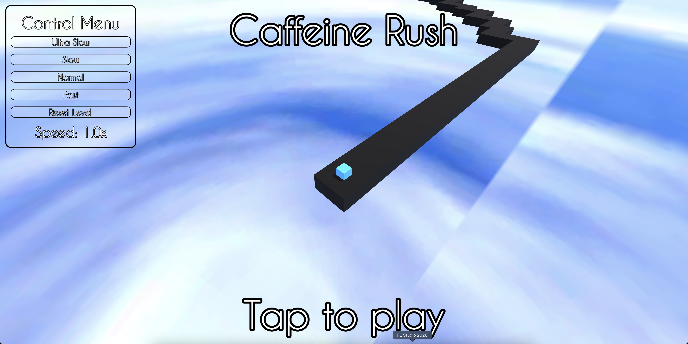

# Dancing Line: Caffeine Rush

A Dancing Line fanmade level with the song Caffeine Rush by [boksed](https://www.youtube.com/channel/UCPf5Oa4MEeFiV-4KaEj9Scg)  

Check it out [here!](https://ruzet.itch.io/dancing-line-caffeine-rush)

   

If you are unfamiliar with Dancing Line, [watch this!](https://youtu.be/LS6rWlSakPQ)  

I used Godot to make this project, pretty cool game engine, x!!  

This game works for Mac, has NOT BEEN TESTED ON A REAL WINDOWS MACHINE  

If you're on Mac, you might have to allow the app in run in Settings -> Privacy & Security  

If you want to test the Windows build to see if its working it should have:

* Normal-looking camera movements
* Speed controls working
* Non offset music
* Working death

# Controls

Click/Z/Space - Change Line Direction  
Tab - Open/Close Control Menu  

